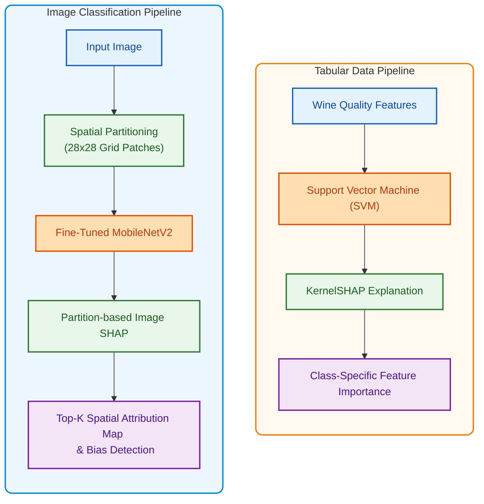
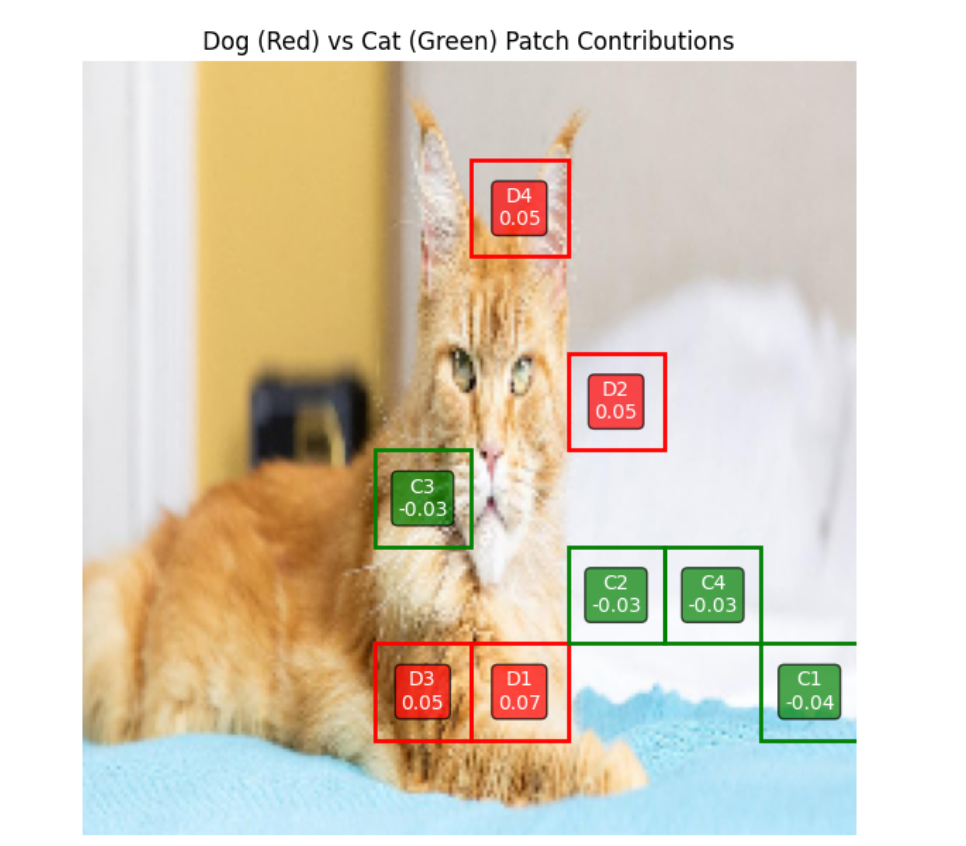
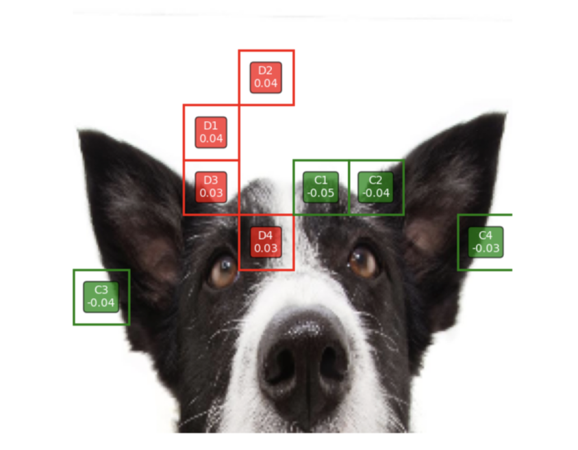

<h1 align="center"> Beyond Local Explanations: Investigating SHAP
Performance and Challenges in Image Classification
and Tabular Data</h1>

  
  
  
  
  

---

## Abstract

This study focuses on the application of **SHAP (Shapley Additive Explanations)** to interpret complex machine learning models, specifically focusing on a MobileNetV2 and an SVM model for tabular data. For image classification, a **partition-based Image SHAP** approach was utilized, where pixel-level attributions were aggregated into 28×28 fixed-size grid patches to enhance interpretability and reduce noise. For the tabular
dataset, **KernelSHAP** was applied to reveal class-specific feature influences and address the effects of class imbalance. The results indicate that while the image model achieves high accuracy,SHAP analysis reveals a significant reliance on background regions rather than object-specific features. Furthermore, the study demonstrates that class-specific feature attribution and correlation-based confidence scores provide deeper insights into the decision strategies of multiclass models. Despite computational costs and sensitivity to background cues, the findings suggest that careful aggregation and visualization of SHAP values can lead to meaningful local explanations for both image and
tabular data.

---

##  System Architecture & Workflow

---

##  Keywords

`Explainable AI (XAI)` • `SHAP` • `MobileNetV2` • `KernelSHAP` • `Background Bias Detection` • `Model Interpretability`

---

##  Experimental Setup & Datasets

| Modality | Target Model | Dataset | Interpretability Method | Key Focus |
| :--- | :--- | :--- | :--- | :--- |
| **Vision** | MobileNetV2 (Fine-Tuned) | PetImages (Cats vs Dogs) | Partition-based SHAP ($28\times 28$) | Background vs Foreground Feature Reliance |
| **Tabular** | Support Vector Machine (SVM) | Wine Quality Dataset | KernelSHAP | Imbalanced Class Feature Attribution |

---

##  Feature Attribution & Visual Results

Below are **Top-K Spatial Patch Attribution Maps** generated via Partition-based Image SHAP ($28 \times 28$ spatial grid partitioning), comparing model focus across Cat and Dog test instances.

  
  &nbsp;&nbsp;&nbsp;&nbsp;
  

  <i>Figure 1: Side-by-side Top-K Spatial Patch Attribution Maps for Cat (left) and Dog (right) instances. Red bounding boxes denote positive contributions pushing toward <b>Dog</b> ($D1-D4$), while green boxes denote contributions pushing toward <b>Cat</b> ($C1-C4$). Note the background and artifact reliance across both classes.</i>

---

##  Key Takeaways & Core Findings

- **Background Bias Exposure:** High validation accuracy can be deceptive. SHAP attributions revealed that the vision model frequently leveraged background context rather than target object semantics.
- **Noise Reduction via Partitioning:** Aggregating fine-grained pixel attributions into fixed $28 \times 28$ spatial grid partitions significantly decreased attribution noise, producing clear local heatmaps.
- **Multi-Modal Diagnostic Capability:** Combining Partition-based SHAP for deep visual networks and KernelSHAP for tabular kernel models provides a unified framework for model auditing.
- **Spotting Class Imbalance via SHAP Changes:** Unbalanced data caused SHAP feature rankings to shift, proving that tracking these score changes and confidence levels can help detect model errors and overfitting on minority classes.

---

##  Implementation & Technical Stack

This repository contains the experimental code, Jupyter Notebooks, and interpretability workflows developed for this research:

- **Computer Vision Interpretability:** Built with `PyTorch` and `SHAP` using $28 \times 28$ spatial grid partitioning to explain fine-tuned **MobileNetV2** predictions on visual data.
- **Tabular Data Interpretability:** Implemented with `Scikit-Learn` (SVM) and `KernelSHAP` to audit feature attributions under class imbalance on the **Wine Quality** dataset.
- **Experimental Notebooks:** The notebooks located in `cat_or_dog_model_dataset/` and `tabular_data_classification/` document the dataset preparation, attribution calculation, and heatmap generation processes.

---

This project is open for educational and research purposes under the [MIT License](LICENSE).
